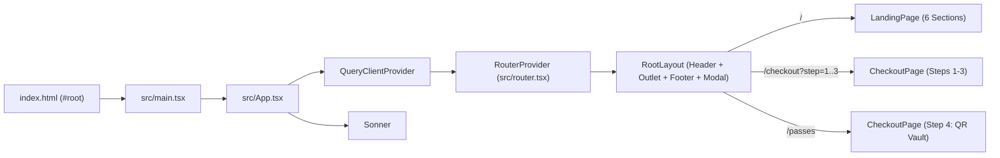
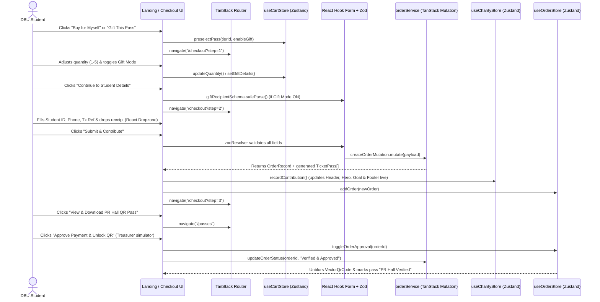

# Rotaract Club of Debre Berhan — Charity Movie Night Frontend
## Architecture, File Reference, Application Flow & Hands-On Developer Guide

This document explains the **entire folder structure**, **every file's responsibility**, **how data and user actions flow through the application**, and **how to develop, extend, test, and connect a backend yourself**.

---

## 1. Complete Folder Structure

```text
charity-ticket-frontend/
├── index.html                          # HTML shell, page title, Google Fonts (Inter & Manrope)
├── package.json                        # Dependencies & npm scripts (dev, build, lint, test, test:e2e)
├── vite.config.ts                      # Vite 8 + React + Tailwind v4 + chunk splitting + Vitest config
├── tsconfig.json                       # Root TypeScript solution config + @/* path alias
├── tsconfig.app.json                   # Strict TypeScript config for src/ application code
├── tsconfig.node.json                  # TypeScript config for Vite, Playwright, and E2E scripts
├── eslint.config.js                    # ESLint flat config (TS, React Hooks, React Refresh)
├── components.json                     # shadcn/ui CLI configuration (Tailwind v4 + Lucide icons)
├── playwright.config.ts                # Playwright browser E2E test runner configuration
├── .gitignore                          # Git exclusions (node_modules, dist, playwright reports)
│
├── public/                             # Static public assets served from "/"
│   ├── favicon.svg
│   └── icons.svg
│
├── e2e/                                # Real-browser Playwright End-to-End tests
│   └── charity-movie-night.spec.ts
│
└── src/                                # Application source code (aliased as "@/*")
    ├── main.tsx                        # React 19 entry point (mounts <App /> into #root)
    ├── App.tsx                         # Root providers (QueryClientProvider, RouterProvider, Sonner Toaster)
    ├── router.tsx                      # TanStack Router route tree (/, /checkout, /passes)
    ├── index.css                       # Tailwind v4 import, @theme brand palette, global CSS helpers
    │
    ├── types/                          # Centralized TypeScript interfaces & domain types
    │   ├── index.ts                    # Barrel export
    │   ├── event.types.ts              # EventMetadata, CharityMilestone, ContributorFeedItem, etc.
    │   ├── ticket.types.ts             # TicketTierId, TicketTier, TicketPass, CartSummary
    │   └── order.types.ts              # PaymentChannel, OrderStatus, GiftDetails, BuyerInfo, OrderRecord
    │
    ├── config/                         # Static app & brand configuration (zero hardcoded UI data)
    │   ├── theme.config.ts             # 60-30-10 brand hex palette (PALETTE)
    │   ├── event.config.ts             # EVENT_META, HIGHLIGHTS_DATA, HOW_IT_WORKS_STEPS
    │   ├── tickets.config.ts           # TICKET_TIERS (Individual 150 ETB, Group 500 ETB), max limits
    │   └── payment.config.ts           # Telebirr & CBE account numbers, instructions, 10MB file limit
    │
    ├── mocks/                          # Seed mock data used until the real backend is connected
    │   ├── charity.mock.ts             # CHARITY_MILESTONES (15k/30k/45k) & INITIAL_CONTRIBUTOR_FEED
    │   └── orders.mock.ts              # INITIAL_ORDERS (sample verified PR Hall pass)
    │
    ├── services/                       # Backend API contracts & mock implementations
    │   ├── api.types.ts                # IEventService, ITicketService, IOrderService interfaces
    │   ├── mockEventService.ts         # Mock event/tier/milestone queries + TanStack Query keys
    │   ├── mockOrderService.ts         # Mock order creation (with date-fns) & receipt verification
    │   └── index.ts                    # Service facade (swap mocks -> real HTTP API here later)
    │
    ├── store/                          # Global client state (Zustand stores)
    │   ├── index.ts                    # Barrel export
    │   ├── useCartStore.ts             # Ticket quantities, Gift Mode toggle, gift details, cart totals
    │   ├── useCharityStore.ts          # Live raised ETB, student count, contributor stream
    │   ├── useOrderStore.ts            # Orders ledger, selected active order, treasurer approval toggle
    │   └── __tests__/
    │       ├── useCartStore.test.ts
    │       └── useCharityStore.test.ts
    │
    ├── hooks/                          # Reusable React hooks
    │   ├── useClipboard.ts             # Copy-to-clipboard with fallback + Sonner toast feedback
    │   └── useEventQueries.ts          # TanStack Query hooks (useEventDetailsQuery, useMilestonesQuery, useTicketTiersQuery)
    │
    ├── lib/                            # Core utilities & library singletons
    │   ├── env.ts                      # Typed environment variables (VITE_API_BASE_URL, VITE_USE_MOCKS)
    │   ├── queryClient.ts              # TanStack QueryClient singleton configuration
    │   └── utils.ts                    # cn() class merging helper (clsx + tailwind-merge)
    │
    ├── components/                     # Shared UI & layout components
    │   ├── layout/
    │   │   ├── navigationContext.ts    # Context providing section scroll & purchase/modal actions
    │   │   └── AppLayout.tsx           # RootLayout (Header + Outlet + Footer + Modal) & route views
    │   └── common/
    │       ├── Header.tsx              # Sticky navbar, live ETB raised pill, mobile drawer
    │       ├── Footer.tsx              # Editorial footer, live total, back-to-top button
    │       ├── PrHallLocationModal.tsx # Accessible DBU PR Hall campus entry guide modal (Esc support)
    │       ├── RotaractMovieEmblem.tsx # Brand SVG cinema crest
    │       ├── VectorQrCode.tsx        # Deterministic 21x21 SVG QR matrix generator
    │       └── __tests__/
    │           └── VectorQrCode.test.tsx
    │
    ├── features/                       # Feature-sliced pages & domain UI
    │   ├── landing/                    # 6-Section Editorial Landing Page ("/")
    │   │   ├── LandingPage.tsx         # Composes all 6 sections in order
    │   │   ├── HeroSection.tsx         # Headline, live fundraising progress bar, hero photo & seat badge
    │   │   ├── CharityGoalSection.tsx  # 4 stat cards, 3 unlockable milestones, live contributor stream
    │   │   ├── AboutSection.tsx        # Rotaract Debre Berhan story & 100% accountability callout
    │   │   ├── HighlightsSection.tsx   # 6 highlight cards, 4 event info cards, PR Hall SVG wayfinding map
    │   │   ├── TicketsSection.tsx      # 2 perforated ticket-stub cards ("Buy for Myself" / "Gift This Pass")
    │   │   └── HowItWorksSection.tsx   # 4-step PR Hall entry timeline
    │   │
    │   └── checkout/                   # 4-Step Ticket Purchase, Gifting & QR Pass Vault ("/checkout", "/passes")
    │       ├── CheckoutPage.tsx        # Renders CheckoutProgressHeader + active step (1..4)
    │       ├── CheckoutProgressHeader.tsx # Back to landing + 4-step navigation bar
    │       ├── checkout.schema.ts      # Zod validation schemas for Gift details & Checkout form
    │       ├── PassSelectionStep.tsx   # Step 1: Quantity steppers (1–5), Gift Mode toggle, live impact sidebar
    │       ├── StudentDetailsStep.tsx  # Step 2: React Hook Form + Zod + Telebirr/CBE copy + React Dropzone
    │       ├── ConfirmationStep.tsx    # Step 3: Order confirmation + updated live charity progress bar
    │       ├── QrPassVaultStep.tsx     # Step 4: Vector QR passes, Treasurer approval toggle, Donor Ledger table
    │       └── __tests__/
    │           ├── checkout.schema.test.ts
    │           └── CheckoutFlow.test.tsx
    │
    ├── test/
    │   └── setup.ts                    # Vitest setup (@testing-library/jest-dom/vitest)
    │
    └── __tests__/
        └── App.test.tsx                # Full <App /> runtime & routing smoke test
```

---

## 2. File-by-File Breakdown

### Root & Tooling Files
- **`index.html`**: Loads `Inter` and `Manrope` from Google Fonts, sets SEO metadata, and provides `<div id="root"></div>`.
- **`vite.config.ts`**: Configures React, Tailwind CSS v4 (`@tailwindcss/vite`), the `@` -> `./src` alias, Rolldown production vendor chunk splitting (`react-vendor`, `tanstack-vendor`, `forms-vendor`), and Vitest `jsdom` testing.
- **`tsconfig.json` / `tsconfig.app.json` / `tsconfig.node.json`**: Enforces strict TypeScript (`noUnusedLocals`, `noUnusedParameters`, `noFallthroughCasesInSwitch`) across app code, Vite config, and Playwright E2E tests.
- **`components.json`**: Enables `npx shadcn@latest add <component>` to install shadcn/ui primitives directly into `src/components/ui`.

### Core Application Shell
- **`src/main.tsx`**: Imports `src/index.css` and mounts `<App />` inside React `<StrictMode>`.
- **`src/App.tsx`**: Wraps the entire app in:
  1. `<QueryClientProvider client={queryClient}>` (TanStack Query server state cache)
  2. `<RouterProvider router={router} />` (TanStack Router)
  3. `<Toaster />` (Sonner notifications styled in the Dark Coffee / Camel / Cream palette)
- **`src/router.tsx`**: Defines 3 URL routes:
  - `/` -> `LandingRouteView`
  - `/checkout?step=1|2|3|4` -> `CheckoutRouteView` (with validated search parameter `step`)
  - `/passes` -> `PassesRouteView` (direct deep link to Step 4: PR Hall QR Pass Vault)
- **`src/components/layout/AppLayout.tsx`**: Shared frame rendered on every route: sticky `Header`, `<Outlet />` (active page), `Footer`, and `PrHallLocationModal`.

### Data, State & Services Layers
- **`src/types/*`**: Single source of truth for every TypeScript shape (`EventMetadata`, `TicketTier`, `OrderRecord`, `TicketPass`, etc.).
- **`src/config/*`**: All static branding, pricing, event schedule, and payment accounts. Never edit component JSX to change prices or phone numbers—edit `src/config/`.
- **`src/mocks/*`**: Initial seed data (3 charity milestones, 4 recent contributors, 1 verified order).
- **`src/services/*`**: Defines backend API interfaces (`api.types.ts`) and exports `eventService` and `orderService` via `src/services/index.ts`. UI components **only** talk to `services/` and `hooks/`, never directly to raw mock arrays.
- **`src/store/*`**: Three focused Zustand stores:
  - `useCartStore`: Pass quantities (`individual`, `group`), `isGift`, `giftDetails`, plus pure helper `calculateCartSummary()`.
  - `useCharityStore`: Live `raisedEtb`, `studentContributors`, `contributorFeed`, `recordContribution()`, plus pure helper `calculateCharityMetrics()`.
  - `useOrderStore`: `orders[]`, `activeOrderId`, `addOrder()`, `toggleOrderApproval()`.

---

## 3. How the Application Flows

### 3.1 Boot & Rendering Flow



### 3.2 Complete Ticket Purchase, Gifting & QR Unlock Flow



### 3.3 Separation of State Responsibilities
Knowing **where** state belongs keeps the codebase clean as you grow it:

| State Type | Tool Used | Where It Lives | Examples |
| :--- | :--- | :--- | :--- |
| **URL & Navigation** | TanStack Router | `src/router.tsx` | Current route (`/`, `/checkout`, `/passes`), checkout `?step=2` |
| **Server / Async Data** | TanStack Query | `src/hooks/useEventQueries.ts`, `StudentDetailsStep.tsx` | Event tiers, milestones, `createOrder` mutation loading/error state |
| **Shared Client State** | Zustand | `src/store/*` | Cart quantities, Gift Mode, live ETB total, orders ledger |
| **Form Inputs & Errors** | React Hook Form + Zod | `src/features/checkout/StudentDetailsStep.tsx` | Full name, Student ID, department, phone, Telebirr/CBE ref |
| **Local Ephemeral UI** | React `useState` | Inside individual components | Mobile drawer open/close, PR Hall modal open/close, receipt file preview |

---

## 4. Hands-On Developer Guide ("How to Develop in Your Own Hands")

### 4.1 Daily Terminal Commands

Always run commands inside `charity-ticket-frontend/`:

```bash
cd charity-ticket-frontend

# 1. Start live development server (http://localhost:5173)
npm run dev

# 2. Run unit & integration tests (Vitest + React Testing Library)
npm test

# 3. Run unit tests in watch mode while coding
npm run test:watch

# 4. Run real-browser Playwright E2E tests
npm run test:e2e

# 5. Check ESLint code quality
npm run lint

# 6. Typecheck & build production bundle
npm run build
```

---

### 4.2 Common Development Recipes

#### Recipe 1: Change Event Date, Venue, Prices, or Telebirr/CBE Account
Never hunt through JSX files. Update the config files directly:
- **Event date, venue, seat capacity, charity goal**: edit `src/config/event.config.ts` (`EVENT_META`).
- **Ticket prices, seat counts, benefits, max limit**: edit `src/config/tickets.config.ts` (`TICKET_TIERS`).
- **Telebirr / CBE account numbers & instructions**: edit `src/config/payment.config.ts` (`PAYMENT_CHANNELS`).
- **Brand colors**: edit both `src/config/theme.config.ts` (`PALETTE`) and `@theme` in `src/index.css`.

#### Recipe 2: Add a New Section to the Landing Page
1. Create a new component file in `src/features/landing/FaqSection.tsx`.
2. Give the `<section>` an `id="faq-section"` so header/footer smooth scrolling can jump to it.
3. Import and render `<FaqSection />` inside `src/features/landing/LandingPage.tsx`.
4. (Optional) Add `{ label: 'FAQ', id: 'faq-section' }` to `NAV_LINKS` in `src/components/common/Header.tsx`.

#### Recipe 3: Add a New Page / Route in TanStack Router
1. Create your feature component (e.g., `src/features/transparency/TransparencyPage.tsx`).
2. Add a route view wrapper in `src/components/layout/AppLayout.tsx`.
3. Register the route in `src/router.tsx`:
   ```ts
   const transparencyRoute = createRoute({
     getParentRoute: () => rootRoute,
     path: '/transparency',
     component: TransparencyRouteView,
   });

   const routeTree = rootRoute.addChildren([
     indexRoute,
     checkoutRoute,
     passesRoute,
     transparencyRoute,
   ]);
   ```
4. Navigate to it anywhere using `const navigate = useNavigate(); navigate({ to: '/transparency' });`.

#### Recipe 4: Add a New Field to the Checkout Form (Zod + React Hook Form)
Example: adding a `dormBlock` field:
1. Add `dormBlock` to `BuyerInfo` in `src/types/order.types.ts`.
2. Add validation to `createCheckoutOrderSchema` in `src/features/checkout/checkout.schema.ts`:
   ```ts
   dormBlock: z.string().trim().min(1, 'Dorm block is required.'),
   ```
3. Add `dormBlock: ''` to `defaultValues` in `src/features/checkout/StudentDetailsStep.tsx`.
4. Render the input with `{...register('dormBlock')}` and display `{errors.dormBlock?.message}`.
5. Pass `dormBlock: values.dormBlock` in `createOrderMutation.mutate(...)` and update `checkout.schema.test.ts`.

#### Recipe 5: Add shadcn/ui Components
`components.json` and `src/lib/utils.ts` (`cn`) are already configured. To add any accessible Radix/shadcn primitive:
```bash
npx shadcn@latest add button dialog badge table
```
Components install into `src/components/ui/` where you can style them with your brand tokens (`bg-brand-wine`, `text-brand-cream`, `border-brand-camel`).

#### Recipe 6: Connect Your Real Backend API Later (Zero UI Rewrites!)
When your backend (Node/Express, NestJS, Django, FastAPI, etc.) is ready:
1. Create `.env` in `charity-ticket-frontend/`:
   ```env
   VITE_API_BASE_URL=https://api.rotaractdbu.org/api
   VITE_USE_MOCKS=false
   ```
2. Create `src/services/httpOrderService.ts` implementing the exact `IOrderService` interface from `src/services/api.types.ts`:
   ```ts
   import { env } from '@/lib/env';
   import type { CreateOrderPayload, OrderRecord, OrderStatus } from '@/types';
   import type { IOrderService } from './api.types';

   export const httpOrderService: IOrderService = {
     async createOrder(payload: CreateOrderPayload): Promise<OrderRecord> {
       const res = await fetch(`${env.apiBaseUrl}/orders`, {
         method: 'POST',
         headers: { 'Content-Type': 'application/json' },
         body: JSON.stringify(payload),
       });
       if (!res.ok) throw new Error('Order creation failed');
       return res.json();
     },
     async getOrders() {
       const res = await fetch(`${env.apiBaseUrl}/orders`);
       return res.json();
     },
     async getOrderById(orderId: string) {
       const res = await fetch(`${env.apiBaseUrl}/orders/${orderId}`);
       return res.ok ? res.json() : null;
     },
     async updateOrderStatus(orderId: string, status: OrderStatus) {
       const res = await fetch(`${env.apiBaseUrl}/orders/${orderId}/status`, {
         method: 'PATCH',
         headers: { 'Content-Type': 'application/json' },
         body: JSON.stringify({ status }),
       });
       return res.json();
     },
   };
   ```
3. Flip the single export in `src/services/index.ts`:
   ```ts
   export const orderService: IOrderService = env.useMocks
     ? mockOrderService
     : httpOrderService;
   ```
4. None of your UI components (`StudentDetailsStep`, `QrPassVaultStep`, `CharityGoalSection`, etc.) need to change!

#### Recipe 7: Writing Tests for New Features
- **Pure logic / Zustand store / Zod schema tests**: place in `src/<module>/__tests__/<name>.test.ts` and run `npm test`.
- **Interactive component / multi-step tests**: use `@testing-library/react` + `@testing-library/user-event` (see `src/features/checkout/__tests__/CheckoutFlow.test.tsx`).
- **Full browser E2E tests**: add test cases to `e2e/charity-movie-night.spec.ts` and run `npm run test:e2e`.

---

## 5. Golden Rules Before Committing Code

Run this single command before every git commit to guarantee zero regressions:

```bash
npm run build && npm run lint && npm test
```

1. **No hardcoded business data inside components** — keep data in `src/config/`, `src/mocks/`, or `src/services/`.
2. **Preserve the 60-30-10 brand palette** — use `PALETTE` or Tailwind `brand-*` theme tokens.
3. **Never import `mock*Service` directly in UI components** — always import from `@/services` or `@/hooks/useEventQueries`.
4. **Always use `useWatch` (not `watch`) in React Hook Form** to stay compatible with React Compiler & ESLint.
5. **Keep route files pure** — export routes from `src/router.tsx` and React components from `src/components/layout/AppLayout.tsx` so Vite Fast Refresh stays healthy.
